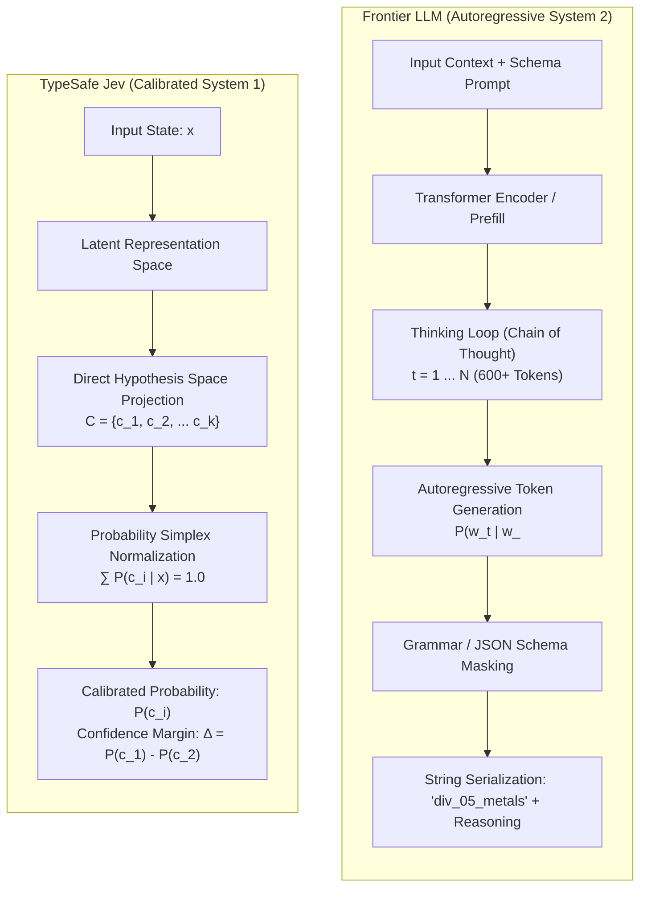
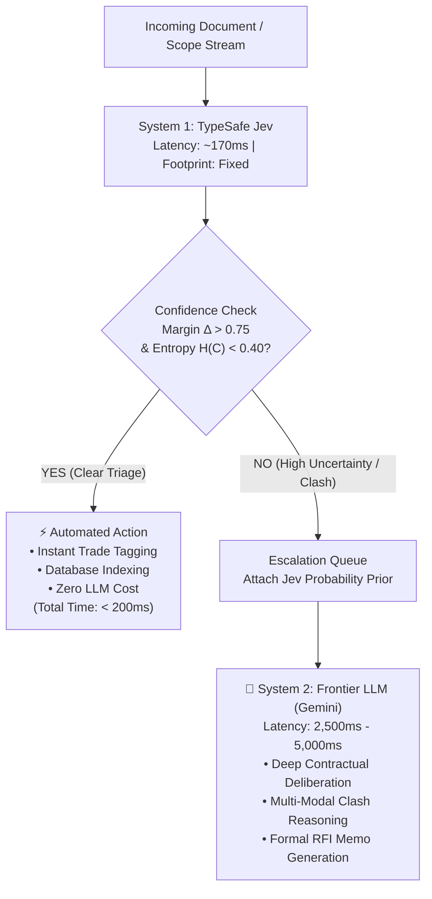

# Model Thinking: System 1 Decision Primitives vs. Frontier LLMs
This document serves as an empirical study, architectural post-mortem, and cognitive evaluation of **TypeSafe's Jev** (a "System One" decision model) benchmarked against **Google Gemini** frontier models (`gemini-2.5-flash`, `gemini-2.5-pro`, and `gemini-3.8-flash`).

It explores the model-thinking behind decoupling fast, calibrated probabilistic judgments from heavy autoregressive reasoning, and demonstrates why specialized System 1 models provide superior speed, mathematical calibration, and cost efficiency for operational classification in domain-specific applications like construction document intelligence.

---

## 1. The Core Thesis: Kahneman’s Dual-Process Theory in Software Architecture

A pervasive anti-pattern in modern AI engineering is treating every classification, routing, and scoring task as an autoregressive generative Large Language Model (LLM) problem. 

When developers need to categorize a sentence, assess risk, or check a boundary condition, the default instinct is often to dispatch a prompt to a multi-billion parameter frontier model, enforce a JSON schema, and wait for tokens to stream back. While frontier models exhibit remarkable general reasoning, using an autoregressive deliberator for deterministic classification introduces severe latency penalties, runaway token costs, and illusory confidence.

In cognitive science, Daniel Kahneman’s dual-process theory (*Thinking, Fast and Slow*) characterizes human cognition as two distinct modes:

```
┌────────────────────────────────────────────────────────────────────────┐
│                   Dual-Process Cognitive Duality                       │
├───────────────────────────────────┬────────────────────────────────────┤
│       System 1 (Intuitive)        │       System 2 (Deliberative)      │
│  Fast • Parallel • Calibrated     │  Slow • Sequential • Analytical    │
│  Reflexive categorical perception │  Multi-step logic & verbalization  │
│  Outputs probability distributions│  Outputs autoregressive tokens     │
└───────────────────────────────────┴────────────────────────────────────┘
```

### The Problem Space in Construction Intelligence (AEC)
In commercial construction platforms like **Project Baldur**, analyzing a 300-page project manual or drawing set involves thousands of discrete evaluations:
- *Scope Triage*: Which CSI MasterFormat trade division owns this sentence?
- *Ambiguity Rating*: Is this field instruction standard practice or a contractual risk?
- *Boundary Checking*: Does this discrepancy necessitate an official Pre-Bid Request for Information (RFI)?

For 90% of these evaluations, the system does not need a conversational essay or multi-paragraph justification; it requires an **instant, typed, mathematically calibrated probability distribution**. Using a frontier LLM—incurring 1,500ms to 5,000ms latency, hundreds of "thinking tokens", and stochastic verbosity—to route a trade scope is like commissioning a team of structural engineers to sort incoming mail.

---

## 2. Theoretical Foundations: Why System 1 Models Excel at Classification

To understand why System 1 architectures are fundamentally superior for classification and triage, we must examine the computational mechanics of how autoregressive LLMs process categories versus how calibrated decision models project hypotheses.

### Computational Mechanics Comparison



### 1. Decoding Complexity and Memory Bandwidth
- **Autoregressive Frontier Models ($O(N)$ Forward Passes)**: An LLM generates answers token-by-token. Even when constrained by grammar masks or JSON schemas, each token requires loading model weights into memory from HBM, computing KV-cache lookups, and evaluating a softmax over a 256,000-token vocabulary. For complex models with chain-of-thought ("thinking") enabled, generating 1,000 output tokens requires 1,000 sequential passes through the neural network.
- **System 1 Decision Models ($O(1)$ Direct Scoring)**: System 1 models evaluate the representation directly against the defined hypothesis space $\mathcal{C}$. There is no unrolling of conversational tokens, no intermediate chain-of-thought buffer, and no grammar serialization. The latency is bound strictly by the single forward pass representation, enabling sub-200ms execution.

### 2. Epistemic Calibration vs. Token Confidence
Autoregressive LLMs are trained to maximize token likelihood, not output calibrated probabilities over task categories.
- When an LLM outputs `{ "ambiguity_level": "low" }`, it asserts a single discrete token. It hides the underlying entropy: was the model 99% confident, or was it a 51/49 coin toss between "low" and "medium"? While token logprobs can be extracted, they reflect token prediction confidence, not calibrated real-world uncertainty.
- In contrast, **TypeSafe Jev** maps the state directly onto the probability simplex:
  $$\Delta^{k-1} = \left\{ (p_1, \dots, p_k) \in \mathbb{R}^k \;\middle|\; \sum_{i=1}^k p_i = 1, \; p_i \ge 0 \right\}$$
  It yields an exact probability distribution across categories, enabling downstream algorithmic systems to measure **Shannon Entropy**:
  $$H(C) = -\sum_{i=1}^k P(c_i) \log_2 P(c_i)$$

---

## 3. The 3 System 1 Decision Primitives

TypeSafe Jev discards open-ended prompts in favor of three typed decision primitives:

```
┌────────────────────────────────────────────────────────────────────────┐
│                      Jev System One Primitives                         │
├──────────────┬─────────────────────────────┬───────────────────────────┤
│ Primitive    │ Mathematical Space          │ Output Attributes         │
├──────────────┼─────────────────────────────┼───────────────────────────┤
│ 1. choice    │ Categorical (Discrete Set)  │ Winner, P(c), Margin (Δ)  │
│ 2. score     │ Ordinal Rubric (Ordered)    │ Expected E[S], Dist P(s)  │
│ 3. noul      │ Binary Truth {0, 1}         │ Calibrated P(true) ∈ [0,1]│
└──────────────┴─────────────────────────────┴───────────────────────────┘
```

1. **`choice` (Categorical Selection)**: Evaluates a mutually exclusive set of categories. It calculates not only the winning choice probability $P(c_{(1)})$, but the **confidence margin**:
   $$\Delta = P(c_{(1)}) - P(c_{(2)})$$
   A margin of $\Delta = 1.0$ indicates zero ambiguity; a margin of $\Delta = 0.05$ signals that the model sees near-identical support for two competing trades.
2. **`score` (Ordinal Rubric Evaluation)**: Rather than arbitrary integer ratings, `score` evaluates input against an ordered semantic rubric (e.g. `low` $\to$ `medium` $\to$ `high`). It returns both the primary tier and the expectation $\mathbb{E}[S]$ across the distribution, capturing continuous nuance without arbitrary token scoring.
3. **`noul` (Binary Calibrated Truth)**: A specialized primitive for evaluating propositions. It outputs a calibrated probability $P(\text{true} \mid x) \in [0.0, 1.0]$, avoiding binary "yes/no" hallucination.

---

## 4. The Model Comparison Studio & Visual Arena

To empirically test these hypotheses, I built the **Model Comparison Studio**—a standalone TypeScript testing laboratory. 

The test harness accepts arbitrary scope statements and compiles dynamic question schemas concurrently for both TypeSafe Jev (as native `systemOne` primitives) and Google Gemini (as strict `@google/genai` JSON Schemas with accompanying `_reasoning` fields). Calls are dispatched in parallel via `Promise.allSettled` to record raw outputs, token footprints, and millisecond latencies.

<p align="center">

</p>


### The Benchmark Scenario: Scope Triage
In the test run captured above, both models were fed an identical, realistic construction specification clause:

> *"Furnish and install all structural steel framing, joists, and metal decking per AISC 360-16 specifications. Field verify existing column elevations prior to fabrication. All touch-up shop primer included."*

The dynamic evaluation schema evaluated three dimensions:
1. `trade_division` (`choice`): CSI Division 03 (Concrete), Division 05 (Metals), Division 09 (Finishes), Division 23 (HVAC), Division 26 (Electrical), or Other.
2. `ambiguity_level` (`score`): Low (clear standards), Medium (standard field verification requirements), or High (missing dimensions/conflicts).
3. `requires_rfi` (`noul`): Binary assessment of whether an official Pre-Bid RFI is required before estimating.

---

## 5. Empirical Results & Benchmark Analysis

The empirical run data persisted in `jev-sandbox/runs/history.json` revealed dramatic differences between the two architectures:

| Evaluation Dimension | TypeSafe Jev (v1.13) | Google Gemini (gemini-2.5-flash) | Delta / Ratio |
|---|---|---|---|
| **Round-Trip Latency** | **177 ms** | **4,989 ms** (with thinking) | **28.2x Faster** |
| **Output Token Footprint** | **129 tokens** | **1,009 tokens** | **7.8x Smaller** |
| **Thinking Tokens Incurred** | **0 tokens** | **698 tokens** | N/A (No reasoning loop) |
| **Categorical Triage (`trade_division`)** | `div_05_metals` ($P = 1.0, \Delta = 1.0$) | `div_05_metals` | **Aligned (Agreement)** |
| **Ambiguity Rating (`ambiguity_level`)** | `medium` ($P = 0.50$, score $0.76$) | `low` | **Divergent** |
| **RFI Gate (`requires_rfi`)** | `false` ($P(\text{true}) = 0.43$) | `false` | **Aligned (Agreement)** |
| **Qualitative Explanation** | None (Numerical/Probabilistic) | 4 structured reasoning paragraphs | Gemini provides narrative |

### Analysis of the Divergence: The Ambiguity Dilemma
The most insightful finding of the benchmark is the divergence on `ambiguity_level`:
- **Gemini asserted `low` ambiguity**, reasoning that AISC 360-16 is a clear standard and that "field verification of existing column elevations" is merely routine procedure.
- **Jev selected `medium` ambiguity**, but its true power lay in its probability distribution:
  - $P(\text{medium}) = 0.50$ (Standard trade scope with common field verification)
  - $P(\text{low}) = 0.37$ (Clear specifications, minimal uncertainty)
  - $P(\text{high}) = 0.13$ (Ambiguous responsibilities or missing dimensions)
  - **Confidence**: $0.26$

Jev detected that while the material specification is pristine, the phrase *"Field verify existing column elevations prior to fabrication"* introduces operational uncertainty regarding who absorbs the cost if elevations deviate. 

An autoregressive model forced to output a single string completely obscured this tension. Jev's output warned downstream software that confidence was low ($26\%$), with a significant probability mass leaning toward field variance.

---

## 6. The Production Paradigm: "Fast Gate, Slow Deliberator"

The conclusion from this experiment is not that System 1 models replace frontier LLMs, but rather that building high-performance AI systems requires a **Cognitive Hierarchy**:



### Why the Hybrid Model Wins
1. **Interactive UI Ergonomics**: At 177ms, System 1 operations can run live on every keystroke or canvas selection in Project Baldur. Tooltips, trade tags, and ambiguity badges appear instantly. At 4,989ms, frontier models lock the UI into waiting spinners.
2. **Economic Efficiency**: Routing 90% of unambiguous scope items through lightweight System 1 endpoints cuts API costs by over 95%.
3. **Targeted Deliberation**: System 2 reasoning is reserved exclusively for high-entropy anomalies, contract disputes, and complex cross-sheet constructability conflicts where narrative explanation is actually needed.

---

## 7. The Collaboration Manifest & Retrospective

* **The Collaboration Manifest**: *Model-first exploration / Empirical benchmark triage.*  
  I maintained tight focus on the cognitive philosophy and evaluation metrics—defining the dynamic question primitives, schema criteria, and human-in-the-loop review criteria. The agent orchestrated the TypeScript harness, API proxies, and parallel benchmarking pipelines.
* **Key Learning**: Building an isolated sandbox (`jev-sandbox/`) before integrating a new model into a production application is essential. It allowed us to scientifically measure latency, token economics, and probability calibration without introducing dependency bloat or architectural churn into Project Baldur.

*Note: The Jev Sandbox and benchmark suites reside in a private development repository. This document serves as a technical record of the comparative methodologies and cognitive architecture findings.*

